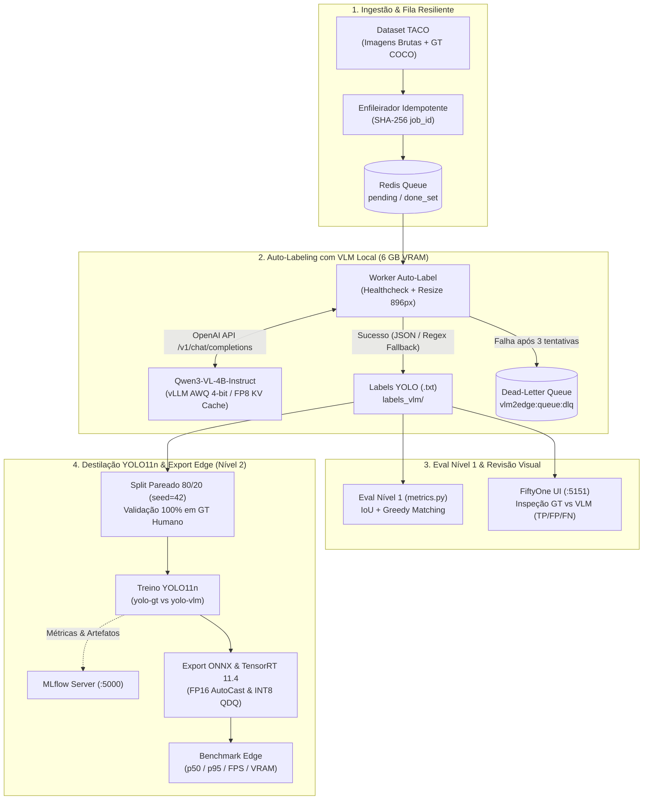

# VLM2Edge-AutoLabel

> **Destilação VLM → YOLO11n → TensorRT para Edge AI:** O detector YOLO11n treinado 100% com rótulos gerados localmente pelo `Qwen3-VL-4B-Instruct` (AWQ 4-bit via vLLM) atinge **83,6% do mAP50** (`40,27%` vs `48,15%`) e **98,6% da Precisão** (`66,63%` vs `67,60%`) do modelo treinado com anotação humana, reduzindo o custo manual de rotulagem a zero e rodando a **122,0 FPS (`p50 = 7,96 ms`) em TensorRT FP16** (e **36 MiB de VRAM em INT8**).

---

## O Problema & A Solução

Rotular milhares de imagens para Visão Computacional é caro e lento. Modelos Multimodais de Linguagem e Visão (VLMs) conseguem detectar objetos *zero-shot*, mas exigem gigabytes de VRAM e centenas de milissegundos por imagem — inviáveis para dispositivos de borda em tempo real.

**`VLM2Edge-AutoLabel`** implementa um pipeline completo e resiliente de **destilação de dataset**:
1. **Rotulagem Assíncrona Resiliente**: Um VLM quantizado (`Qwen3-VL-4B-Instruct` em 4-bit servindo via **vLLM** ou **llama.cpp**) consome tarefas de uma fila **Redis** com controle de idempotência (`SHA-256`), *retry* automático e *Dead-Letter Queue* (DLQ).
2. **Avaliação em 2 Níveis & Observabilidade**:
   - **Nível 1 (Qualidade do Rótulo)**: Cálculo determinístico de IoU, *greedy matching*, Precisão, Recall e F1 contra o Ground Truth humano + inspeção visual no **FiftyOne**.
   - **Nível 2 (Qualidade do Detector Destilado)**: Treinamento comparativo (`yolo-gt` vs `yolo-vlm`) rastreado no **MLflow**, avaliado rigorosamente sobre o **mesmo conjunto `val` humano**.
3. **Otimização Edge**: Exportação automatizada para **ONNX**, **TensorRT FP16** e **TensorRT INT8** (calibrado com *NVIDIA ModelOpt*), com benchmark de latência (`Mean`, `p50`, `p95`, `FPS`, `VRAM`) em CPU e GPU.

---

## Arquitetura



---

## Resultados Experimentais

Todos os experimentos foram executados localmente em uma **NVIDIA GeForce RTX 4050 Laptop (6 GB VRAM)** + **Intel Core i5-13420H** sob WSL2 (Ubuntu 24.04) utilizando o dataset público **TACO (Trash Annotations in Context)**.

### 1. Avaliação Nível 1 — Qualidade Zero-Shot do VLM (`IoU >= 0.5`)

Comparação direta das caixas geradas pelo `Qwen3-VL-4B-Instruct-AWQ-4bit` contra as anotações humanas do TACO, sem nenhum fine-tuning prévio:

| Amostra Avaliada | True Positives (TP) | False Positives (FP) | False Negatives (FN) | **Precision** | **Recall** | **F1-Score** |
|---|---:|---:|---:|---:|---:|---:|
| Subset Inicial (150 imagens) | 171 | 28 | 371 | **85,93%** | 31,55% | 46,15% |
| **Dataset Expandido (981 imagens)** | **1.147** | **193** | **1.808** | **85,60%** | **38,82%** | **53,41%** |

> **Diagnóstico (via FiftyOne)**: O VLM apresenta **altíssima precisão (~86%)** — quando detecta um resíduo, a caixa é bem localizada. O recall moderado (`38,8%`) decorre de micro-objetos secundários no fundo (bitucas/fragmentos distantes), enquanto os objetos principais em primeiro plano são consistentemente rotulados.

---

### 2. Avaliação Nível 2 — YOLO Treinado no VLM vs YOLO Treinado no GT Humano

Ambos os modelos (`yolo11n`, 50 épocas, `imgsz=640`, `seed=42`) foram treinados no mesmo conjunto de imagens de treino (785 imagens) e avaliados sobre o **mesmo conjunto de validação humano (196 imagens, 639 instâncias GT)**:

| Modelo | Fonte dos Rótulos de Treino | Fonte do `val` (196 imgs) | Precision | Recall | **mAP50** | **mAP50-95** | **Retenção vs Humano** |
|---|---|---|---|---:|---:|---:|---:|---:|
| **`yolo-gt` (Baseline)** | 100% Humano (`labels_gt`) | Humano (`labels_gt`) | 67,60% | 42,25% | **48,15%** | **33,95%** | 100,0% |
| **`yolo-vlm` (Destilado)** | **100% Qwen3-VL (`labels_vlm`)** | **Humano (`labels_gt`)** | **66,63%** | **37,50%** | **40,27%** | **27,51%** | **83,6% mAP50 / 98,6% Precisão** |

---

### 3. Tempo e Custo por 1.000 Imagens (VLM Local vs Anotação Humana)

| Método | Tempo p/ 1.000 Imagens (~3.000 boxes) | Custo Direto Estimado | Intervenção Humana | Latência de Inferência Final |
|---|---:|---:|---:|---:|
| **Anotação Humana Manual** | ~16 a 25 horas humanas | ~US\$ 150 – US\$ 300 *(US\$ 0,05–0,10/box)* | 100% manual | — |
| **Qwen3-VL-4B Direto na Borda** | ~3h 50min *(~14s/img na RTX 4050)* | ~US\$ 0,08 *(energia local)* | Zero | ~14.000 ms (**0,07 FPS**) ❌ |
| **Pipeline `VLM2Edge` (VLM → YOLO TRT)** | ~3h 50min (rotulagem) + 18min (treino) | **~US\$ 0,10 *(energia local)*** | **Zero (ou revisão seletiva)** | **8,20 ms (122,0 FPS)** ✅ |

---

### 4. Benchmark de Inferência & Trade-off de Quantização (`mAP × Latência × FPS × Memória`)

Avaliação do modelo destilado (`yolo-vlm`) exportado para diferentes runtimes (50 imagens pré-carregadas em RAM após 10 execuções de warmup; `mAP` medido nas 196 imagens do split `val` humano):

| Formato / Runtime | Dispositivo | Tamanho em Disco | VRAM Alocada (Contexto) | Mean (ms) | p50 (ms) | p95 (ms) | **FPS** | **mAP50** | **mAP50-95** | Retenção mAP50 vs `.pt` |
|---|---|---:|---:|---:|---:|---:|---:|---:|---:|---:|
| `best.pt` (PyTorch) | CPU (i5-13420H) | 5,23 MB | — | 80,78 | 81,91 | 97,95 | **12,4** | 39,36% | 27,53% | 100,0% |
| `best.onnx` (ONNX Runtime) | CPU (i5-13420H) | 10,17 MB | — | 63,57 | 62,52 | 73,78 | **15,7** | 38,87% | 27,41% | 98,8% |
| `best.pt` (PyTorch) | GPU (RTX 4050) | 5,23 MB | ~180 MiB | 21,84 | 20,00 | 39,72 | **45,8** | **39,36%** | **27,53%** | 100,0% |
| **`best_fp16.engine` (TensorRT 11.4)** | **GPU (RTX 4050)** | 59,36 MB | **65 MiB** | **8,20** | **7,96** | **10,92** | **122,0** | **38,84%** | **27,40%** | **98,7%** |
| **`best_int8.engine` (TensorRT 11.4)** | **GPU (RTX 4050)** | **31,11 MB** | **36 MiB** | **8,49** | **7,77** | **12,59** | **117,8** | **38,17%** | **26,59%** | **97,0%** |

---

## Decisões de Arquitetura & Trade-offs

1. **Por que `Qwen3-VL-4B-Instruct` (AWQ 4-bit) e não `Thinking` ou `FP8`?**
   - Em uma GPU de **6 GB de VRAM** (com ~1,0 GB consumido pelo WDDM do sistema operacional), os pesos do modelo + encoder visual 16-bit + `lm_head` ocupam **4,24 GiB** no vLLM.
   - A variante `Thinking` consome centenas de tokens extras de raciocínio sem ganho prático em regressão de coordenadas `bbox_2d`.
   - Limitar `max_pixels: 501760` (~640 tokens visuais), `max_model_len: 1536` e ativar `--kv-cache-dtype fp8` (suportado nativamente na arquitetura Ada Lovelace) foi essencial para evitar *thrashing* na memória compartilhada PCIe durante o *profiling* do encoder visual.
2. **Resiliência na Fila Redis + Parser Tolerante a Truncamento**:
   - Imagens densas (>25 objetos) podem atingir `max_tokens` antes de fechar o colchete JSON `}]`. Em vez de descartar a imagem inteira no `json.loads`, o [`QwenVLClient.parse_qwen_boxes`](src/vlm2edge/vlm/client.py) aplica um fallback de extração das tuplas `bbox_2d` completas já emitidas, reduzindo falhas na DLQ a zero.
   - O worker aguarda ativamente o endpoint `/v1/models` estar saudável antes de fazer `BLPOP` na fila, evitando drenar jobs para a DLQ durante o *cold start* do vLLM.
3. **Trade-off FP16 vs INT8 no TensorRT**:
   - **TensorRT FP16** entregou **2,66x mais throughput** que o PyTorch na mesma GPU (`122,0 FPS` vs `45,8 FPS`) e **9,8x mais que a CPU**, preservando **98,7% do mAP50** (`38,84%` vs `39,36%`).
   - **TensorRT INT8** (calibrado estaticamente com *ModelOpt QDQ* no próprio dataset TACO) reduziu o tamanho do engine em **47%** (`31,1 MB` vs `59,4 MB`) e a alocação de VRAM do contexto em **45%** (`36 MiB` vs `65 MiB`), com queda residual de apenas `0,67` p.p. de mAP50 em relação ao FP16 — excelente quando múltiplos modelos dividem a memória de um dispositivo embarcável (ex.: Jetson Orin Nano).

---

## Quickstart (WSL2 + Docker + `uv`)

```bash
# 1. Instalar dependências do projeto
make sync

# 2. Baixar dataset TACO + subir Redis e vLLM (Qwen3-VL-4B AWQ 4-bit)
make download-taco TACO_LIMIT=1000
make up-vllm

# 3. Enfileirar imagens (idempotente) e rodar o worker de auto-label
make enqueue
make worker

# 4. Rodar suíte de testes, avaliar Nível 1 (VLM vs GT) e inspecionar no FiftyOne (:5151)
make test
make eval
make fiftyone

# 5. Parar vLLM (liberar VRAM), subir MLflow (:5000) e treinar YOLO11n (GT vs VLM)
make split-yolo
make train-yolo

# 6. Exportar para ONNX + TensorRT (FP16 e INT8) e rodar Benchmark
make export-trt
make benchmark
```

---

## Estrutura do Repositório

```text
VLM2Edge-AutoLabel/
├── docker-compose.yml           # Redis 7.4, vLLM (Qwen3-VL AWQ), llama.cpp (GGUF) e MLflow
├── Makefile                     # Automação completa do pipeline (sync, worker, eval, train, export, benchmark)
├── pyproject.toml               # Dependências gerenciadas com uv, ruff e pyright
├── src/vlm2edge/
│   ├── types.py                 # Contratos Pydantic (YoloBox, LabelJob)
│   ├── datasets/
│   │   ├── taco.py              # Downloader TACO e conversor COCO -> YOLO normalizado
│   │   └── splits.py            # Gerador de splits pareados (validação 100% em GT humano)
│   ├── queue/
│   │   └── redis_queue.py       # Fila Redis resiliente (idempotência SHA-256, retry, DLQ)
│   ├── vlm/
│   │   └── client.py            # Cliente OpenAI-compatible p/ Qwen3-VL com resize e fallback regex
│   └── eval/
│       ├── metrics.py           # IoU, greedy box matching, Precision, Recall e F1 (implementado à mão)
│       └── benchmark.py         # Estatísticas de latência p50, p95, Mean e FPS (implementado à mão)
├── scripts/                     # CLIs de execução de cada etapa do pipeline
└── tests/                       # Testes unitários PyTest (test_metrics.py, test_benchmark.py)
```

---

## Limitações Conhecidas & Próximos Passos

- **Recall em Objetos Pequenos/Oclusos (`38,8%` no Nível 1)**: Em cenas com dezenas de pequenos fragmentos distantes, o VLM *zero-shot* prioriza os objetos salientes.
  - **Fase 2 (Planejado)**: *Fine-tuning* com **QLoRA (Unsloth)** no `Qwen3-VL` usando um pequeno subconjunto revisado no FiftyOne + estratégia de *Active Learning* (acionar o VLM apenas em frames onde o YOLO apresenta baixa confiança).
- **Integração Physical AI (Projeto 2 — `vision-agent`)**: Os eventos gerados pelo detector TensorRT alimentarão um pipeline de raciocínio sobre vídeo com Postgres + `pgvector`, servidor **MCP** e agente **LangGraph**.

---

## Licença

O código-fonte deste repositório é distribuído sob a licença **MIT**.
*Nota sobre dependências de terceiros*: O treinamento e exportação YOLO utilizam a biblioteca [Ultralytics](https://github.com/ultralytics/ultralytics), licenciada sob **AGPL-3.0** para uso open-source (para implantações comerciais fechadas sem liberação de código-fonte, verifique o licenciamento Enterprise da Ultralytics ou utilize runtimes inferenciais independentes como ONNX Runtime / TensorRT direto).
